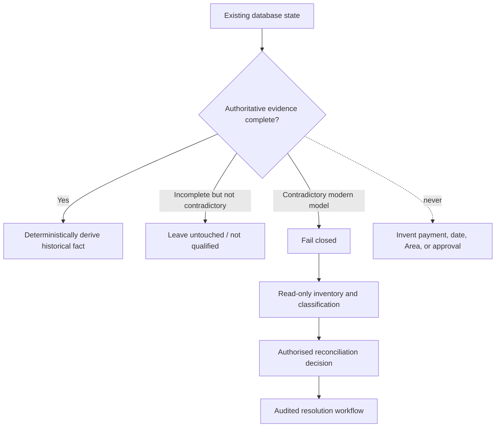
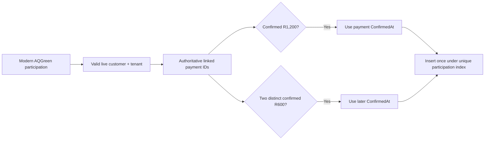
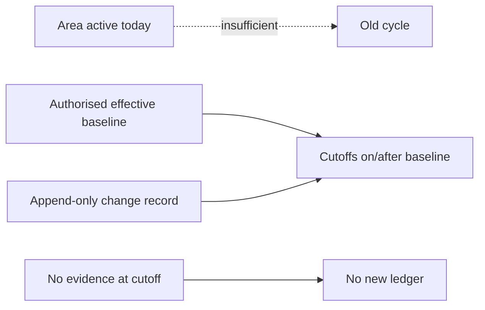
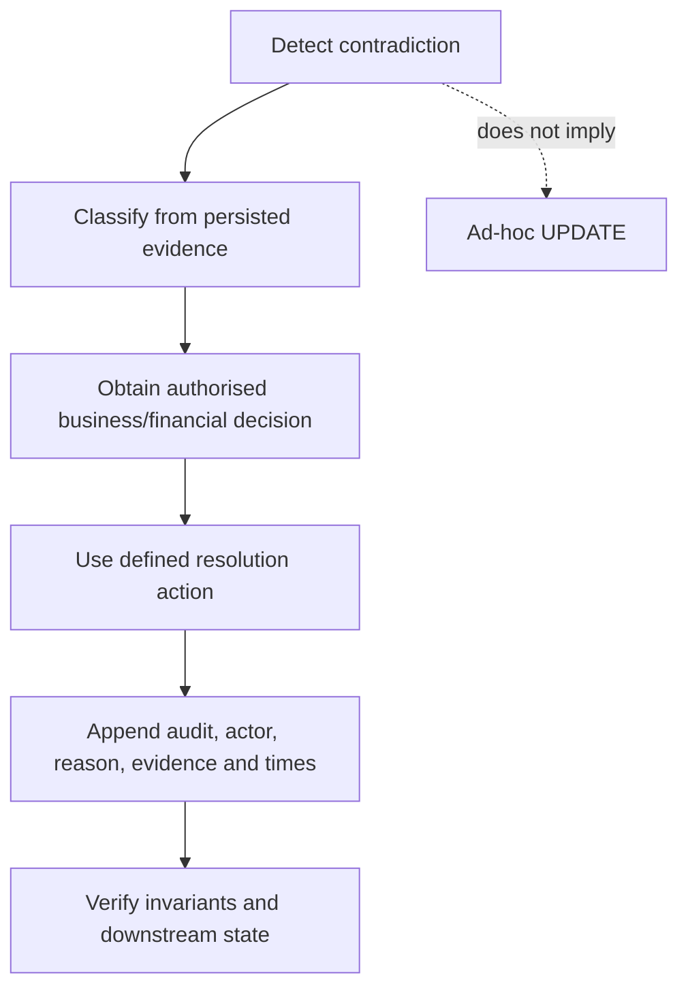

# Data history, migrations, and legacy members

The central historical-integrity rule is:

> Do not manufacture historical facts merely because the modern system expects modern records.

This applies to payments, programme state, Area state, network placement, funeral-cover inclusion, terms, obligations, commissions, and reconciliation.

## 1. The distinctions that protect history

```text
current state != historical evidence
legacy participation != modern payment transaction
migration != permission to invent history
reconciliation != arbitrary database editing
software deployment date != business effective date
```



## 2. Authoritative facts and projections

| Concern | Strong historical evidence | Projection that is insufficient by itself |
| --- | --- | --- |
| Joining completion | Linked confirmed `MemberPayment` records with purpose, amount, currency, customer, tenant, and `ConfirmedAt` | Participation currently Active or awaiting approval |
| Programme activation | Append-only Area Admin decision and `ActivatedAt` | Payment receipt or browser success return |
| Funeral inclusion | Proven final joining-payment confirmation | Migration execution time, approval time, `UpdatedAt` |
| Network placement | Activation plus valid effective recruiter-correction history | Current recruiter ID alone for an old cutoff |
| Area state | Append-only Area activation records at cutoff | Area active today |
| Commission terms | Immutable terms row effective for the cycle | Current hard-coded terms or deployment date |
| Monthly compliance | Due/grace/payment timestamps and policy coverage | Current obligation status alone |
| Loan compliance | Effective date, due/satisfaction/repayment/deadline facts | Current outstanding/status projection alone |

### Retained sources and the limits of their authority

The following are source contracts identified in code; production availability,
custody, completeness and historical authorization have not been verified here.
A database row is not automatically proof that its historical assertion is true.

| Essential fact | Actual retained source | Can establish, subject to provenance verification | Cannot establish alone |
| --- | --- | --- | --- |
| Member identity / Tenant / Area | `Customers` identity and ownership keys; `CustomerAreaAssignments` effective dates, baseline and audit metadata | Current internal identity; recorded same-Tenant assignment intervals; controlled system-introduction baseline when its migration/authorization provenance is verified | Original Aqua registration, earlier business membership, pre-baseline Area, historical permission from today's security state |
| Sponsor / acquisition | `EntryParticipations` plus complete `EntryRecruiterCorrections`; immutable `AQGreenRecruitmentAttributions` / confirmations and referenced `ProgrammeInvitations` | Recorded recruitment credit and confirmation; conditional reconstruction from validated complete corrections and activation | Original sponsor from current recruiter alone, invitation existence as acceptance, root acceptance from a null recruiter, facilitator/Area-leader referral as AQGreen member sponsorship |
| Joining money / finality | Owned linked `MemberPayments`; matching joining checkout; authenticated processing evidence in `YocoWebhookReceipts` and provider/accounting evidence retained by the operator | Recorded purpose/amount/currency/confirmation and accepted-event provenance when ownership, reference, finality and chronology reconcile | Cash/legacy payments never recorded here; provider settlement/refund/reversal state from `Confirmed` alone; `ProcessedAt` as provider capture time; browser return as payment |
| Approval / activation | `EntryParticipationApprovalDecisions`, `ActivatedAt`, contemporaneous Area/actor authority evidence | Matching recorded positive approval/activation transition with verified historical authority | Activation from payment, `Customer.IsActive`, current role or migration date; Area authorization merely because an actor ID is present |
| Placement / populations | `AQGreenNetworkPlacements` and tree scopes; V1 `EffectiveProgrammeNetwork` and B6 derived analysis; D03B root dispositions / D09 populations | Observed V2 placements; conditional V1 reconstruction and separately reviewed B6 proposals | An immutable stored V1 placement history (none identified); topology as sponsor credit or financial eligibility; current status as exact old-cutoff lifecycle; a proposed scope as historical root |
| Ordering / corrections | `StartedAt`, verified activation, complete `EntryRecruiterCorrections`; existing V1/B6 ordering logic; `AQGreenMigrationBackup` | Conditional as-of recruiter/order reconstruction; backup of old terms version/effective date from the joining transformation | Invented tie times, missing corrections, old terms as proof of payment or original activation; technical GUID tie-break order as recruitment time |

No authoritative original member-register, cash/bank/payment ledger, legacy sponsor
register or legacy approval-document format has been supplied. No adapter is built
for those unknown formats. Real legacy-only facts remain unresolved until those
sources and their identity/provenance mappings are available.

## 3. Legacy AQGreen members

Legitimate Aqua members may predate modern application onboarding and have no `EntryParticipation`, checkout, or `MemberPayment` history. Their absence from modern tables is not proof that they did not pay or are not covered.

They are also not candidates for a migration based on modern payment evidence. The system must not:

- create placeholder customers;
- create fake R1,200 or R600 payments;
- invent confirmation timestamps;
- force already-covered legacy members through new-customer joining;
- infer an external insurer date from software data.

`PLANNED`: a future audited legacy-member import should capture identity, real AQGreen participation, known Aqua inclusion/cover facts, source evidence, authorising operator, business-effective date when known, and import recording time. Unknown dates must stay unknown. This workflow is not implemented by the funeral-cover migration.

When V2 joining is explicitly selected, a current AQGreen membership assignment
blocks prospective joining and joining-checkout preparation with
`Existing AQGreen membership requires reconciliation.` The assignment is preserved;
the member must not pay to join again through this path. This guard also applies to
direct checkout of an existing pending participation. It does not prove historical
payment, activation, sponsor or cover, and absence of an assignment does not prove
the member is new. B6 reconciliation must classify the full accepted population
before production V2 selection; D03B/D09 govern legacy mapping and D10/B7 governs
cutover. Existing V1 behavior remains authoritative while V2 is disabled.

### Frozen discovery evidence for offline B6 review

`ExportLegacyAQGreenReconciliationEvidence` extends the existing discovery query;
it does not perform B6 reconciliation. The API accepts an explicit Tenant, optional
Area, `WholeTenant` flag and UTC analysis cutoff. It reads all pages inside one
PostgreSQL `REPEATABLE READ READ ONLY` transaction. Scoped exports require active
assigned Areas. Whole-Tenant exports require host identity and the explicit
`Admin.AllTenants` permission. Both discovery-view and the separate
`Admin.ProgrammeParticipations.ExportLegacyReconciliationEvidence` permissions are
required; role seeders do not automatically grant the bulk permission.

The restricted operator package contains customer/Tenant/current-Area identity,
legacy membership and participation references, classifications and issue codes;
allowlisted joining payments/checkouts, approval decisions, recruiter corrections,
immutable attribution/confirmation and placement references/times when present.
Current Area, recruiter and participation status are current observations, not
exact historical values. Recorded activation without a matching approval remains
unverifiable. Outside-population recruiter/sponsor/placement-parent identifiers
are withheld with explicit issues. Names, contact details, member numbers, provider
references, monthly financial history, actor identifiers and free text are omitted.
The endpoint disables auditing of export inputs/results. Keep packages outside Git
and logs, in restricted operator storage; technical IDs and joining amounts remain
sensitive. This is not the sanitised external B6 handoff.

`AQGreenB6ReconciliationDiscoveryEvidenceV2` uses the existing B6 canonical UTF-8
JSON, SHA-256 and `B6TUPLE1` population-digest conventions. The result supplies
`Manifest`, `Records` and `Sha256Sums`; `ManifestBytes()` and `RecordsBytes()` give
the exact bytes for `manifest.json` / `records.json`, with UTF-8 `SHA256SUMS`.
`Verify()` rejects altered hashes, scope, duplicates, ordering or counts. The
manifest records source tables, exported source/category counts, schema and
implementation digests, PostgreSQL version, observation time and hashed MVCC/
database identity. Stable content/population hashes repeat for unchanged source
content, scope, cutoff and implementation. The full manifest hash additionally
seals source observation boundaries, which may differ on another extraction.
The cutoff is for offline analysis; it does not reconstruct mutable state at that
historical time or filter the observed inventory into an eligibility population.

V2 adds the established `CustomerAreaAssignments` source to the same snapshot and
hash/count conventions. Each allowlisted row includes source assignment ID,
authorized Area identity, effective interval, migration-baseline/tombstone flags,
recording/modification/deletion times and actor-presence booleans. Free text and
actor identities are omitted. History is constrained to the exact returned
customer/Tenant identities; unauthorized former Area IDs are withheld explicitly.
Retained deleted rows remain visible as tombstones. Missing history, earlier
unknown intervals, baseline limits, gaps, overlaps and current-projection conflicts
are recorded. Existing review processing preserves these supplemental issues and
blocks effective acceptance while audit/authorization provenance remains unknown.

This table is effective-dated but mutable/audited, not an immutable authority.
`AreaHistoryEvidenceIssues` always requires audit/authorization corroboration;
the supplement never approves a member or clears other historical uncertainties.
It is hashed into each discovery record and the exact manifest, so older review
acceptance cannot be reused silently. Archived V1 packages retain their original
canonical bytes/hashes; absent V1 supplement fields mean history was not exported,
not that no Area history existed. The old synthetic artifacts are retained intact.
Current exports always emit V2; no uncertainty-triggered downgrade to V1 exists.

The package can be deserialised without database access and supplied to
`SimulateWholeScope` with explicit source-bound review classifications for every
record, including legacy-only records. Existing B6 simulation emits proposals,
anomalies and structural impact; missing facts produce anomalies with no placement
proposals. Partial Area packages and omitted/duplicate/unbound review records are
rejected. Review snapshot keys are offline identities, not new participation IDs.
Review hypotheses are counterfactual inputs, not source facts or authorisation.
Multiple legacy components need authoritative component/population dispositions
before any accepted scope analysis; this preliminary envelope is not an approved
`BASE_SNAPSHOT`, `FINAL_ANALYSIS` manifest or production application input. It
contains neither inferred historical roots nor fabricated financial eligibility.
Authoritative B6 data review, approved evidence/custody and B7/D10 cutover remain
separate gates. Runtime production gates are unchanged.

### Source-bound offline component and population reviews

`AQGreenFrozenReconciliationReview.SealInventory` seals declared B6 component
identities, exact discovery-record membership/digests and dependency edges. It
keeps `canonicalisation`, `qualificationEligibility` and
`historicalImpactInventory` distinct; each population must explicitly classify
every frozen record as Included, Excluded or Unverifiable. Components are supplied
by reviewed analysis, never inferred from Area, placement parents or absent history.
Retained sponsor/recruiter/correction links must be accounted for as dependencies.

`Process` binds each decision to the exact source content and full manifest hash,
Tenant/Area population scope, inventory digest, subject identity/membership and
evidence/review-contract versions. It reuses B6 controlled decision references,
reviewer-role labels, source/base-manifest fields, `B6TUPLE1`, accepted/quarantined
component digests and the self-excluding `receiptDigest` convention. This is the
`AQGreenB6DiscoveryReviewBindingV1` adapter for preliminary discovery evidence,
not a second governance authority or an approved B6 root/execution/handoff receipt.

Reviewer authority must be supplied separately from decisions as independently
verified owner/operator evidence covering the exact source, inventory, subject,
decision identity, role and effective authorization window. Role claims and
hash-shaped strings cannot establish that authority. The pure library validates
these supplied bindings; it does not authenticate arbitrary uploaded authority,
issue grants, accept roots or establish the truth of external historical evidence.
No new production HTTP endpoint or authority bootstrap is provided.

Explicit ACCEPTED/QUARANTINED decisions require controlled reason codes. Source
historical issues remain unchanged and force effective quarantine even when a
review requests acceptance. Omitted decisions/membership, cyclic or unaccepted
dependencies and unverifiable populations are reported explicitly and cannot
produce complete whole-Tenant acceptance. Duplicate/conflicting decisions,
incorrect identities/membership, unsupported versions and mismatched authority
are rejected. Receipt replay is deterministic for identical frozen inputs;
`VerifyReceipt` reprocesses decisions against trusted authority and rejects altered
or conflicting receipts. A new source observation/manifest needs new review
bindings even if its content digest is unchanged. Preserve review inputs and
receipts in restricted operator storage outside Git/logs.

All outcomes are `OFFLINE_REVIEW_BINDING_ONLY`. Review acceptance is neither
authoritative D03B/D09 data reconciliation nor B6 execution permission, financial
eligibility or B7/D10 activation. Existing B6 FINAL_ANALYSIS verification,
sanitisation/custody, execution authority and production gates remain required.

## 4. AQGreen joining migration provenance

Migration `20260726162000_AddAQGreenSingleJoiningPayment` created `AQGreenMigrationBackup` before changing the joining model. The backup preserves each migrated participation's prior terms version and effective date so a later investigation can distinguish records transformed from an older lifecycle.

The backup is provenance, not a payment ledger. It cannot prove that a customer paid, approve a participation, or create a funeral entitlement on its own.

Its downgrade path refuses to proceed when new checkouts or confirmed joining history would make restoration unsafe. A verified database backup or reviewed forward remediation is required instead of a lossy downgrade.

## 5. Funeral-cover backfill

Migration `20260809043240_AddAQGreenFuneralCoverEntitlements` applies the same qualifying event used at runtime to modern in-system records.

### Deterministic candidates

The migration requires a live customer/tenant relationship and a supported modern AQGreen joining model. It creates one inclusion only when linked evidence proves either:

1. one confirmed ZAR 1,200 AQGreen joining payment; or
2. two distinct confirmed ZAR 600 AQGreen joining payments.

For the full path, `IncludedAt` is that payment's `ConfirmedAt`. For instalments, it is the later `ConfirmedAt`.



Incomplete payment is not ambiguity: it receives no entitlement and migration continues. Current Active/Rejected/awaiting status is not used as a shortcut.

### Contradictory modern data

The migration raises a clear PostgreSQL exception when a scanned modern record contradicts the required facts, including examples such as:

- customer/tenant mismatch or missing live customer;
- unsupported terms/amount/currency for the modern model;
- start before the terms boundary;
- mixed full and instalment references;
- reuse of one payment in both instalment slots;
- a completed-like status without qualifying linked payments;
- linked confirmed payments with wrong purpose, amount, customer, tenant, currency, or timestamp.

This `P0001` guard prevents the migration from “fixing” a contradiction by inventing history. See the active incident status in [document 04](04-payments-approval-and-yoco.md).

### Duplicate and rollback behaviour

- Backfill avoids an existing participation entitlement.
- A unique index on `EntryParticipationId` is the final duplicate guard.
- Runtime inclusion uses the same one-per-participation invariant.
- `Down` drops the entitlement table. After production use that destroys both backfilled and newly earned records. Safe operations require backup/restore or reviewed forward remediation; a synthetic rollback would be dishonest.

## 6. Decision uniqueness migration

Migration `20260809042322_EnforceSingleProgrammeParticipationDecision` adds the database invariant that a participation has at most one AQGreen or Onyx approval decision. It first refuses to proceed when historical duplicates exist.

The migration does not choose which contradictory decision is “correct.” That requires authorised reconciliation of the audit evidence.

## 7. Flexible joining migration

Migration `20260809052330_EnableAQGreenFlexibleJoiningPayments` introduces the selectable R1,200 or R600+R600 modern schedule while retaining historical payment links. Its rollback refuses to remove the capability after two-instalment history exists.

This chronology matters:

```text
decision uniqueness
    -> funeral-cover entitlement/backfill
    -> flexible joining support
```

The funeral migration recognises the authorised modern terms versions and linked payment facts. Migration filenames and order must not be rearranged merely to simplify presentation.

## 8. Monthly due-policy and checkout history

The monthly due-policy table starts empty and is append-only. A policy records a version, due day, and effective month boundary. Update, delete, truncate, and evidence-losing rollback are rejected after policy evidence exists.

Monthly checkouts link to a specific obligation. Contradictory or unlinked allocation becomes `ReconciliationRequired`; no oldest-open fallback is authoritative.

Discovery endpoints expose legacy joining and monthly checkout reconciliation rows to authorised Area/host operators. They are read-only. Issue #66 tracks the missing authorised resolution workflow.

`GetLegacyAQGreenReconciliation` now inventories live Tenant customers with a
current AQGreen membership assignment or an AQGreen participation, including
legacy-only assignments with no participation. Referenced membership assignments
whose ownership cannot be verified are explicit uncertainty candidates. Shared
membership definitions and definitions belonging to the customer's Tenant are
valid lookup sources; another Tenant's definition supplies no membership authority.
Customer/participation joins match both Tenant and customer identity. Tenant
administrators receive only their active assigned Areas; central discovery requires
the existing `AllTenants` permission. Unassigned-Area customers are visible only to
the authorized central scope. Soft-deleted customers/participations retain the
existing exclusion; an absent live record does not prove no historical record exists.

The response has one row per Tenant/customer, ordered by Tenant then customer ID,
with stable `DiscoveryId`, `CustomerId` and any existing `ParticipationId`. Offset
pagination is deterministic for an unchanged population; it is not a frozen B6
snapshot. The old zero-instalment restriction is removed, so modern schedules are
also discoverable. `ParticipationId` and participation amounts are now nullable;
consumers must inspect `ParticipationVersionEvidence` and `HistoricalEvidenceIssues`
instead of treating missing values as zero. No frontend currently consumes this DTO.

`DiscoveryKind` distinguishes legacy assignment with recorded V2 provenance,
legacy assignment without a live participation, V2 candidates with evidence
issues, and unverifiable information. Coherent recorded V2 facts have a separate
`V2RecordedFacts` category. An `EntryParticipation` alone cannot establish V2;
recognized V2 attribution/placement rules are recorded evidence, not activation or
historical membership authority. Existing participation with unknown/unsupported
version remains unverifiable even when a legacy assignment exists. Issue codes identify missing participation,
membership/sponsor/activation uncertainty, absent confirmation, unsupported rules,
and conflicting/unverifiable joining-payment links. Confirmed ledger facts may have
an explicitly missing confirmation timestamp; they are not silently discarded.
Payment and checkout details are restricted to the returned customer's Tenant and
ownership. Unverifiable linked payment identifiers are withheld with an issue code.
`CHECKOUT_OWNERSHIP_UNVERIFIABLE` and `CHECKOUT_PAYMENT_LINK_UNVERIFIABLE` explain
withheld checkout facts or payment references; absence of returned details must
not be interpreted as evidence that no checkout or payment exists.

Discovery does not infer an original sponsor, payment, approval time, root mapping,
or membership validity, and does not repair or create records. Ordinary ABP access
auditing remains in place. Authoritative B6 reconciliation and D03B/D09 mapping,
and B7/D10 production selection/activation, remain separate owner-gated operations.

## 9. Area activation baselines

The new business `Area` aggregate is distinct from the older tenant-scoped commission activation terminology. Customer Area membership has its own effective-dated `CustomerAreaAssignment` history. The Johannesburg migration records a system-introduction baseline only; it does not claim an earlier movement or business activation date. See [document 08](08-area-and-tenant-boundaries.md).

Commission calculation needs to know whether a target Area was active at the historical cutoff. “The Area is active now” cannot prove that fact.

The older append-only commission activation history supports prospective observation and change at its tenant-scoped calculation boundary. It does not seed or backfill activation facts from current state. Every activation baseline must be explicitly authorised, and cutoffs before the first reliable record remain unknown. This is separate from the owner-authorised current Johannesburg customer assignment baseline.



## 10. Effective date versus deployment date

These are different concepts:

- **Business effective date**: when authorised terms or a state applies.
- **Payment confirmation time**: when a qualifying financial fact occurred.
- **Entitlement time**: the qualifying final payment's confirmation time.
- **Deployment time**: when code reached an environment.
- **Recording time**: when Aqua stored a fact or operator assertion.
- **External provider date**: an insurer/payment/payout fact only when the provider supplies authoritative evidence.

For funeral cover, 26 July 2026 is a technical lower bound for the supported modern joining model. It is not the funeral promise inception or external cover commencement. For commission automation, 14 August 2026 00:00 Johannesburg is the engine's authorised initial effective-dated terms boundary. It is neither merely the software deployment date nor necessarily the date on which Aqua originally created the underlying commission model.

## 11. Reconciliation is a controlled process



The repository currently detects and lists several reconciliation states but does not expose a general audited resolution action. `ReconciliationRequired` is a stop signal, not permission to change financial history.

## 12. Production safety checklist for historical changes

Before a migration or reconciliation affecting historical facts:

1. take and verify a restorable backup;
2. inventory affected rows read-only and exclude PII from reports;
3. identify the authoritative source for each field;
4. distinguish incomplete from contradictory data;
5. obtain business authority for any interpretation;
6. test Up, fail-closed cases, uniqueness, and actual Down consequences on PostgreSQL;
7. preserve provenance and actor/reason evidence;
8. prefer reviewed forward remediation after production use;
9. never alter migration history to bypass a guard.
