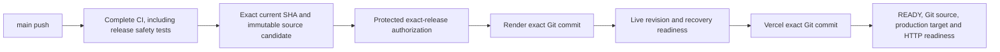

# Qualified automatic deployment

This mechanism is **IMPLEMENTED preparation, not ENABLED**. The owner authorized
investigation, code, tests and a PR, not a deployment or service resumption.
`ac7dfe968ec13fd8c743504e4b531ab5afd2e5e7` is explicitly excluded. Do not rerun its
CI as a deployment shortcut. No production action is required to test this change.

The [PR #105 production-readiness follow-up](pr105-production-readiness.md)
preserves the reproduced CI-attempt binding gap at historical commit `8185fb5`
and outstanding governance/provider prerequisites. The correction uses the version
2 contract below. Final-commit CI and fresh independent review are recorded in
PR #105; earlier preparation PASS is superseded. No activation is authorized.

## Verified investigation, 16 October 2026

| Surface | Read-only evidence | Meaning |
| --- | --- | --- |
| GitHub | Main CI [38889852541](https://github.com/aqua-lifestyle/aqua-lifestyle/actions/runs/38889852541) succeeded at `ac7dfe9`; previously only CI and version-tag image publication existed | A successful merge had no qualified repository release consumer |
| Render | Correct main repository/branch; root Docker context, existing API Dockerfile, empty pre-deploy/start override, auto-deploy off, not suspended; live deployment `dep-db8av3dg1s2s739m6sgg` at `1251fb82979e18be53d1d0e7f5c6fab2d0c50a58` | Live auto-deploy setting agrees with the Blueprint; changing YAML is not an applied provider change |
| Render runtime evidence | Health 200, Healthy database/Redis/Data Protection, Production, exact build `1251fb8`, no recovery header | The older API is actually running outside recovery; health does not expose every effective safety flag |
| Render configuration | Recovery false, Bird true, Yoco test; financial/weekly/monthly/background/demo/pilot/commissioning/seed flags false; no linked environment groups returned | Provider-declared holds, not comprehensive effective-process proof; older recovery-only worklogs are stale for this observation |
| Vercel | Project Git link null, correct frontend root, Node 24; recent production deployments created by CLI | Disconnection prevents a native main Git release. No production Git branch can be verified while disconnected |
| Vercel current target | `dpl_EwGB3apX3P5JnU5KfG3rLzn21Kgf`, READY; custom metadata declares frontend source `6c81fb91afbac0cedb63092cc736e857eb544d82`, without authoritative `gitSource` | Operator metadata is not independent provider Git provenance |
| Vercel build inputs | Both public API/Tenant production variables exist as sensitive/redacted values, even on authorized environment reads | Their actual production values cannot be verified with this credential. They are not assumed correct or absent |
| GitHub protection | Existing environments have no rules/branch policy. Main ruleset prevents deletion/non-fast-forward only | No existing production approval or PR/CI protection can be presumed. A new protected environment must be configured separately |

**ROOT CAUSE established:** repository release gap, Render explicitly off and Vercel
Git disconnected. Why those settings were originally changed, historical integration
permissions and any historical skipped-build behavior remain **UNKNOWN**. No evidence
shows a GitHub CI failure, Render build failure or Vercel ignored-build failure at
the current merge. An ignored-build setting cannot be fully verified while the Git
link is absent. No live setting, credential, service or database was changed.

## One production path



CI validates the full configured inventory. `release.yml` consumes only completed
successful **push** runs of `ci.yml` from this repository's main branch. It verifies
all 17 required job identities/conclusions from the same explicit CI attempt,
latest run attempt, current main HEAD,
checked-out source, and the explicit exclusion before publishing anything.
Failure, cancellation, skipped/missing/duplicate jobs, PR/manual CI, fork inputs or
stale main fail closed. Latest-run reads bracket the attempt-specific job inventory;
a rerun during inspection fails closed. Partial CI reruns cannot borrow successful
jobs from an older attempt: rerun all CI jobs to establish a complete new attempt.
No PR artifact or script is used by `workflow_run`.

The candidate is a deterministic `git archive --format=tar` plus a manifest binding
repository, exact SHA, CI run/attempt, producing release run/attempt, authorized
environment/profile/provider targets and SHA-256. Version 1 manifests are rejected.
Actions stores the immutable
artifact with its own digest for 90 days. Deployment downloads the candidate by
the trusted producing job's artifact ID and compares its bytes with a fresh archive
of the qualified Git commit. The archive is **source/qualification evidence**.
Render and Vercel build that Git revision themselves; they do not run this archive
or the optional GHCR images. No claim of bit-identical provider rebuilds is made:
base images/build infrastructure remain provider inputs. Record provider deployment
IDs and resolved Git source independently. Candidate retention is not permanent
release storage; export required audit evidence to approved custody before expiry.

Version tags retain the separate **publication-only** GHCR convention. Publication
now requires successful full CI on the exact current main revision first; package
write permission exists only after qualification. Tags neither authorize nor
trigger production deployment. Record OCI digests/provenance from that workflow;
do not pass a mutable image tag off as a deployed production digest.

Native Render after-CI deploys cannot perform the coupled recovery authorization
and API-before-frontend checks. Native Vercel main builds would race CI/Render.
Therefore one Actions orchestrator uses each platform's existing native Git build
at an exact SHA. Render auto-deploy and Blueprint auto-sync remain off. Repository
Vercel configuration disables **main** native deployment; other preview conventions
remain unchanged. No deploy hooks, service creation, resume, environment PATCH,
provider enablement, migrations, financial or message operations exist in this path.

## Activation remains BLOCKED: exact owner prerequisites

Do not change today's service merely to make these gates pass. Current recovery
false/Bird/Yoco configuration is incompatible with the **recovery-only** automated
profile. Continuing normal operation under automation requires a separate profile
qualification; this implementation does not grant it.

Before a future separately authorized release, the owner/custodian must:

1. Authorize the exact source/release and establish an **already running** recovery
   baseline through the existing separately governed recovery procedure. A suspended
   service is rejected; this pipeline never resumes it. Verify effective runtime
   flags, provider isolation, startup seeding/repair absence, exact schema compatibility
   and tested rollback/backup evidence. Startup in Production skips the host seeder;
   recovery skips all provider/financial worker registration. Existing startup
   preflight requires exact migration history and never applies or repairs schema.
   History matching alone does not prove absence of manual schema drift.
2. Keep all nine checked holds explicitly false (weekly, monthly, financial,
   background jobs, demo, pilot, D10 commissioning, demo seed and Bird), recovery
   explicitly true, and Yoco mode/secret/webhook and Bird key absent. This is a future
   prerequisite, **not an instruction to remove today's working provider settings**.
   No Yoco Test Mode, Bird cutoff, D10 or financial policy is changed by this PR.
3. Merge the reviewed mechanism only under separate merge authorization. Before any
   Git reconnection, confirm the main-trigger exclusion is effective on main and
   inventory other provider hooks/automations. Keep Render native auto-deploy off and
   Blueprint synchronization off. Limit manual/provider deployments to the custodian
   during an admitted release; Actions concurrency cannot lock out provider admins.
4. Restore Vercel's existing Git access to **this** repository, production branch
   main, existing project/team and root in `tools/deployment/targets.json`. Retain
   `git.deploymentEnabled.main=false`. Remove any ignored-build override through a
   separately approved owner action and verify the effective settings. Production
   `NEXT_PUBLIC_ABP_API_URL` must be exactly `https://aqualifestyle-api.onrender.com`
   and `NEXT_PUBLIC_DEFAULT_TENANT_NAME` exactly `Default`. Make these two **public**
   values verifiable by the deployment identity; redacted/sensitive responses block
   admission. Never make server credentials public or copy them to frontend variables.
5. Create GitHub environment **production-release**: independent eligible required
   reviewer(s), prevent self-review, disable administrator bypass; custom deployment
   branch policy with exactly one **branch**, main. The script verifies these actual
   protection rules. Store least-privilege `RENDER_API_KEY`, `VERCEL_TOKEN` and
   `PRODUCTION_RELEASE_AUTHORIZATION` only in that environment. Do not put provider
   secrets at repository scope. Protect main with reviewed PRs and all current CI
   requirements, with no bypass for deployment control changes; designate reviewers
   for workflows, deployment scripts, targets and runtime safety code. Existing
   deletion/force-push rules do not provide these controls.
6. Enable environment variable `AUTO_DEPLOY_ENABLED=true` **only after** that
   authorization. Missing/false fails visibly. Supply the following per-release
   authorization through secure environment custody, then approve the pending
   exact workflow run. Booleans record the custodian's referenced verification;
   the pipeline does not manufacture or independently establish human authority.

```json
{
  "version": 2,
  "repository": "aqua-lifestyle/aqua-lifestyle",
  "profile": "recovery-only",
  "environment": "production-release",
  "renderServiceId": "srv-d9f0k8e1a83c73d8n1b0",
  "vercelProjectId": "prj_6qL1e43KhsWrRshY5GxdmGl3HGMz",
  "vercelTeamId": "team_Hc3BWfhTLfwLzwbgbtaasBUY",
  "commit": "EXACT_40_CHARACTER_COMMIT",
  "ciRunId": "EXACT_SUCCESSFUL_PUSH_CI_RUN_ID",
  "ciRunAttempt": 1,
  "releaseRunId": "EXACT_QUALIFIED_RELEASE_WORKFLOW_RUN_ID",
  "releaseRunAttempt": 1,
  "expiresAt": "OWNER_APPROVED_UTC_EXPIRY_WITHIN_24_HOURS",
  "authorityReference": "opaque-owner-evidence-reference",
  "baselineRenderDeployId": "dep-APPROVED_BASELINE_ID",
  "baselineVercelDeployId": "dpl_APPROVED_BASELINE_ID",
  "schemaCompatibilityVerified": true,
  "rollbackVerified": true,
  "effectiveRuntimeVerified": true,
  "singleTriggerVerified": true,
  "configurationFreezeVerified": true
}
```

Freeze provider configuration/other deployment mechanisms for the authorized window.
These fields are required evidence references, not example approval to deploy.
Authority binds every manifest identity field, including **both CI and release run
attempts** and exact production targets. It expires within 24 hours and is rechecked
before each new provider POST. Every later qualification must equal the frozen
repository/SHA/CI run/attempt; a newer successful CI attempt is not interchangeable.
Missing, failed, contradictory or unavailable evidence blocks progression.
An unchanged retry requires renewed attempt-specific authority/approval and
**rerun all release jobs** to produce a candidate for that release attempt. A
failed-job-only retry reuses an old candidate and is rejected. The current merge
cannot be authorized through this template because its SHA is independently excluded.

For an authorized partial-release retry only, add numeric `resumeFromReleaseAttempt`
referencing an earlier attempt of the **same release run**. Admission resolves the
unique, unexpired `production-release-audit-{runId}-{attempt}` artifact from that
run, verifies its source metadata and downloads its immutable artifact ID. Every
receipt row must match the source, CI run **and attempt**, targets and prior release
attempt. Provider IDs and their original requesting attempts are retained. No
cross-run, legacy, contradictory, missing or already-verified receipt can authorize
adoption. An unavailable receipt or lost provider response ID requires custodian
reconciliation; matching SHA alone is insufficient. CI-attempt drift cannot be
repaired by reusing the old receipt or approval.

## Readiness, concurrency and failure handling

- Global Actions concurrency serializes the release workflow without cancelling a
  running provider rollout. GitHub may replace an older **pending** concurrency run;
  inspect cancelled/superseded runs. The newest candidate must still pass current-main
  qualification; this is not a promise to release every intermediate main commit.
- After approval, qualification is repeated and compared with the frozen candidate.
  The same comparison gates Render admission, Vercel admission and final verification.
  Provider preflight rejects suspension,
  wrong targets/build/start/pre-deploy settings, changed baseline, operational flags,
  secrets, wrong frontend build target or foreign in-flight deploys. Unknown states,
  incomplete inventories or repeated pagination cursors fail closed. History inspection
  is bounded at 2,000 entries and fails visibly rather than inferring absence.
- A Git comparison against the approved Render baseline blocks changed/renamed
  migration files, non-descendant code and truncated comparisons. Schema-changing
  releases require a separate authorized procedure, not an automatic migrator hook.
- Render receives `commitId` (never branch latest). Poll for `live`, verify resolved
  commit, re-read safety configuration and health build ID, Production/dependency
  readiness and the effective latched recovery header. Failure stops Vercel.
- Recheck the exact frozen CI identity, current main and authority before Vercel.
  Its production request has
  exact `gitSource.sha/ref`, project and repository ID. Poll READY, require provider
  Git source/project, CI run/attempt metadata and canonical release-identity digest,
  no alias error, actual production target ID and production
  HTTP 200. These checks prove infrastructure identity/readiness, not a business
  workflow, authentication acceptance or provider delivery.
- Polling is bounded (20 minutes per provider; overall 45-minute job). A timeout,
  lost POST response or workflow cancellation **does not mean the provider stopped**.
  Do not automatically retry POST, roll back, resume, or repair settings. A renewed
  authorized retry inspects provider history and adopts only an operation recorded
  by its validated immutable audit receipt. Render has no native CI-attempt metadata;
  the receipt supplies that binding. Ambiguous duplicates, unrecorded same-source
  operations and terminal failed candidates require operator action.
  Provider eventual consistency still requires custodian inspection after an
  ambiguous POST; do not use rapid reruns as an exactly-once mechanism.
- GitHub environment/deployment records, candidate digest, workflow step summaries
  and redacted `production-release-audit-*` artifacts record the result and provider
  IDs, including partial completion. Each audit row carries the full release identity;
  failure rows retain known provider IDs and original requesting attempts. Failures
  before identity verification are explicitly marked unverified. Each retry writes
  a separate artifact, preserving earlier records. Enable owner Actions failure notifications;
  verify their delivery separately. Render currently declares notify-on-fail.
  Vercel alert delivery and GitHub notification receipt have not been verified.
  Provider bodies, configuration, keys, identity information and business data are
  never logged by the orchestrator. A blocked admission is a failed check/summary,
  not a silent successful skip. Agent review is not formal GitHub approval.

## Rollback and recovery (separate operator authorization)

1. Stop admission: clear/disable `AUTO_DEPLOY_ENABLED` and revoke the pending exact
   authority; keep native main auto-deploy and Blueprint sync off. This prevents
   future admission, not an already accepted provider action. Inspect provider
   deploy state before doing anything else.
2. Use the audit's approved previous Render/Vercel deployment IDs. Verify backup,
   source/schema compatibility and unchanged safe runtime configuration. No EF Down,
   migration-history editing, database replacement, seeding or provider replay.
3. If only API completed, leave the previous frontend in place and reconcile its
   compatibility; do not promote a frontend whose API readiness failed. If a new API
   is unsafe, use the existing authorized emergency suspension procedure. Suspension
   or resumption is a human operation outside this workflow.
4. Under separate authorization, use Render's **rollback of the approved deploy ID**
   and Vercel's **instant rollback to the approved production deployment ID**, not a
   branch hook or mutable latest tag. Reverify provider IDs, Git revisions, recovery,
   dependency readiness and the production alias. Old binaries must retain safe
   guards/schema compatibility. No automatic database rollback is implied.
5. Preserve failed/partial evidence and configuration custody. After reconciliation,
   issue fresh exact-attempt authority, rerun all release jobs and approve the
   appropriate qualified run. Partial retries require the matching prior audit
   receipt described above; changed CI attempts cannot adopt the old attempt's work.
   A failed earlier Render candidate must be explicitly resolved by the custodian;
   the pipeline will not silently create another one. If source has advanced, the
   old candidate is stale: qualify the new current main revision instead.

## Executable evidence and limits

From repository root: `node --test tools/deployment/*.test.mjs` (Node 24+).
The tests use synthetic API clients/HTTP responses, no credentials, members,
payments, provider calls or production mutations. They cover failed CI, exact source
and archive provenance, protected authority, runtime holds, target/build inputs,
sequential success, stale heads, provider failure, rollback holds, pagination,
concurrency, retry adoption and lost-response redaction. Workflow checks also failed
before adding the missing release path/main exclusion/tag qualification.
The attempt-binding correction first reproduced two failing regressions (successful
CI attempt 2 replacing attempt 1 before Render or after Render/before Vercel).
The expanded 116-case suite passes, including failed/missing/changed CI evidence,
stale authority, partial receipts, concurrent releases and ambiguous responses.
These provider simulations assert that mismatches cause no further mutation.

CI additionally runs the full existing backend/frontend/PostgreSQL inventory and
both container builds. Final commit/run results and independent Agent 2 review are
recorded in the task PR. Simulated provider success/rollback boundaries do not prove
actual deployment, rollback, external notification delivery or production business
operation. No production deployment/activation test has been run for this change.

Primary provider contracts: [GitHub workflow_run security](https://docs.github.com/en/actions/reference/workflows-and-actions/events-that-trigger-workflows#workflow_run),
[Render exact-commit deploys](https://render.com/docs/deploys),
[Vercel deployment API](https://vercel.com/docs/rest-api/deployments/create-a-new-deployment),
[Vercel Git trigger controls](https://vercel.com/docs/project-configuration/git-configuration),
[Render rollback](https://render.com/docs/rollbacks),
[Vercel instant rollback](https://vercel.com/docs/instant-rollback).
