# Qualified unattended deployment

This is IMPLEMENTED preparation for unattended deployment, not production activation.
The latest owner instruction replaces PR #105's per-release human authority with
standing deployment policy. A qualified main merge needs no additional human review,
release token, expiry renewal or per-release secret. Normal independent **PR review**
remains merge governance. Operational activation remains separate from deployment.
No merge, production deployment, provider configuration change or service resumption
is authorized by the implementation task.

The [Scripture-governed safety contract](cicd-safety-contract.md) defines protected
assets, independent control/identity requirements, executable evidence and remaining
uncertainty. Same-repository passing tests do not establish independently protected
security tests, production privilege separation or authenticated backup evidence.
Those properties remain activation blockers in addition to the setup below.

## Verified cause and current blockers

PR #105 merged at `23f176db6eb13af5ee01ff69f1a9f7bbe6b880ff`.
[Release 38912818702](https://github.com/aqua-lifestyle/aqua-lifestyle/actions/runs/38912818702)
qualified its immutable candidate, then failed
`ACTIVATION_BLOCKED_AUTO_DEPLOY_NOT_AUTHORIZED` before the provider step. The
standing switch was absent. Beyond that first failure, the former controller
required exact per-release JSON and human environment approval. Merely setting the
switch would not establish unattended or safe production readiness.

Authorized read-only observations on 16 October 2026:

| Surface | Observed state | Consequence |
| --- | --- | --- |
| GitHub main | 23f176d; deletion/non-fast-forward rules only | Required PR/CI governance is missing |
| production-release | Auto-created without rules, branch restriction, secrets or variables; admin bypass allowed | Environment custody and standing setup remain blocked |
| Render | Existing `srv-d9f0k8e1a83c73d8n1b0`, correct repo/main, root Docker context, `./docker/api/Dockerfile`, empty hooks, native auto-deploy off, not suspended | Identity matches; no settings changed |
| Render runtime | Live `dep-db8av3dg1s2s739m6sgg`, commit `1251fb82979e18be53d1d0e7f5c6fab2d0c50a58`; health 200/Healthy DB, Redis, Data Protection; no recovery header | Effective recovery is not established |
| Render flags | Recovery false, Bird true, Yoco test with configured keys; financial/weekly/monthly/jobs/demo/pilot/D10/seed false | Incompatible with recovery-only automated admission. Do not remove today's keys or change flags to make a gate pass |
| Render ancillary settings | Blueprint autoSync=false; no environment groups returned | Retain single-trigger/configuration custody; declarations do not prove every process setting |
| Vercel | Existing expected project/team, verified www.aqualifestyleclub.co.za, correct root/Node24, no build/install/output override, Git link absent | Exact Git-source deployment remains blocked pending separately authorized Git access setup |
| Vercel provenance/public inputs | Current production target `dpl_EwGB3apX3P5JnU5KfG3rLzn21Kgf` READY, no authoritative Git source; API/Tenant public variables sensitive/redacted | Cannot establish bootstrap frontend provenance or actual build values |
| Credentials | Local credentials permitted GETs; repository/environment Actions secrets absent | Production Actions credential availability and deploy permissions unverified; no write permission probe performed |

These observations are not production acceptance. History, backup/restore, rollback,
alert delivery, unknown private app hooks and all running-process restrictions are
not established by provider declarations or HTTP health alone. Earlier readiness
records remain historical; see [PR #105 assessment](pr105-production-readiness.md).

## One automatic path

```mermaid
flowchart LR
  Main[Reviewed merge to main] --> CI[All 17 CI jobs succeed in one attempt]
  CI --> Candidate[Exact current SHA, policy digest and immutable archive]
  Candidate --> Policy[Standing policy and main-only credential environment]
  Policy --> Baseline[Qualified bootstrap or verified predecessor receipts]
  Baseline --> Render[Exact Render Git commit]
  Render --> Health[Revision, recovery and dependency readiness]
  Health --> Vercel[Exact Vercel Git commit]
  Vercel --> Verified[Production target, provenance, HTTP and audit]
```

One `workflow_run` consumer, global `production-release` concurrency,
`cancel-in-progress=false`, consumes completed same-repository main-push ci.yml
only. All 17 exact required job names must conclude **success**, including release
safety and both container builds. Skipped/neutral/missing/duplicate/mixed-attempt
jobs fail. Latest-run reads bracket the explicit attempt-specific job inventory.
Every subsequent qualification must match the frozen repository/SHA/CI run/attempt.
A newer successful CI rerun cannot replace the frozen attempt.

Candidate manifest version 3 binds source, CI run/attempt, release run/attempt,
standing-policy SHA-256, exact environment/profile and provider targets. The archive
is deterministic Git source, independently compared against the qualified Git
revision after trusted artifact download. No untrusted PR artifact is executed by
workflow_run. Candidates from older contract versions fail closed. Providers rebuild
exact Git source, not the source archive or GHCR images; bit-identical rebuilds are
not claimed. Version-tag image publication remains qualified **publication only**.

Current main and actual merged-PR review evidence are checked before every new
provider POST. The unique merged main PR must identify this exact merge SHA; an
eligible non-author human-account approval must reference its final head and predate
merge. Direct pushes, stale/dismissed approvals, unresolved requested changes,
post-merge approvals, unavailable permission evidence and fork CI inputs fail closed. The
reviewer's current write/admin eligibility is checked. This does not prove historical
permissions, separate human custody or last-pusher identity.

Visible main rules must require reviewed PRs, stale-review dismissal, latest-push
approval, resolved conversations and all 17 GitHub Actions app15368 contexts with
strict up-to-date checks. Read-only GitHub tokens cannot inspect hidden ruleset
bypass actors: absence is **UNKNOWN**, never treated as an empty bypass list. An
owner must qualify no-bypass/settings custody once and preserve it. GitHub's generic
required-check semantics allow skipped/neutral conclusions; this release's own
qualifier separately requires successful execution. Administrators can edit controls;
no source script can defend against an administrator who rewrites its trust boundary.

## Standing setup, without a release token

`tools/deployment/unattended-policy.json` is source-reviewed standing policy, not a
per-release credential. It contains version, epoch, recovery-only profile and one
qualified bootstrap pair. **bootstrap is deliberately null in this PR** because the
current production runtime and frontend provenance cannot be qualified. Missing
bootstrap produces `QUALIFIED_RECOVERY_BOOTSTRAP_REQUIRED`, not fabricated evidence.

A future bootstrap record has these fields, established once under separate setup
authority: `renderDeployId`, `renderSha`, `vercelDeployId`, `vercelSha`,
`releaseFloor` (last release workflow run_number before this policy epoch), and
`evidenceReference` (opaque reference to independently verified recovery/runtime,
source/schema, restorable backup, rollback and single-trigger evidence). Syntax or
a reference string does not itself authenticate that evidence. No booleans, commit
allowlist renewal, release run ID, CI ID, expiry or approval token must be supplied
for each release. Policy changes alter the candidate/audit digest and require a
separately qualified epoch transition rather than reinterpreting earlier receipts.

One-time owner/custodian actions, **not performed here**:

1. Establish main PR/CI protection and independent settings/reviewer custody. Retain
   deletion/force-push protection, all 17 exact check names and GitHub Actions source,
   stale/latest-push review controls, no bypass. Preserve names or use a reviewed
   dual-name transition when CI jobs change. Do not enable merge queue without its
   CI event contract. No automatic merge is added.
2. Configure exact environment `production-release`: one custom **branch** policy
   `main`, no tags/wildcards; `can_admins_bypass=false`; no required reviewers,
   wait timer or custom approval gate. Candidate preflight checks this **before**
   entering the environment so an accidental human gate fails visibly; deployment
   repeats the checks. Do not reuse unprotected Production. GitHub's documented UI
   exposes the admin-bypass setting; read back the effective value.
3. Provision standing least-privilege `RENDER_API_KEY` and `VERCEL_TOKEN` only in that
   main-only environment. Neither credential may grant application financial/provider
   activation by policy. Do not provision PRODUCTION_RELEASE_AUTHORIZATION: it is no
   longer consumed. No administrator credential is needed for governance reads.
   Workflow permissions remain contents/actions/pull-requests read. Never log tokens,
   provider payloads, native member data or configuration responses.
4. Resolve runtime compatibility separately. Recovery-only is the qualified safe
   alternative; it never automatically transitions normal production to recovery.
   If capability preservation is required, separately authorize and qualify a
   normal-operation deployment profile with precise startup/provider boundaries.
   Today's normal Bird/Yoco/business capabilities cannot be preserved by selecting
   recovery. This task neither disables them nor grants a normal-profile bypass.
5. Qualify the already-running recovery bootstrap, schema compatibility/drift,
   restorable backup and exact source/provider rollback pair; record the standing
   policy epoch once. No suspended service is accepted or resumed. Confirm all
   competing manual/app/provider deployment mechanisms are under custodian control.
6. Restore existing Vercel Git repository access only under separate infrastructure
   authority. Verify exact repo/main, project `prj_6qL1e43KhsWrRshY5GxdmGl3HGMz`,
   team `team_Hc3BWfhTLfwLzwbgbtaasBUY`, root
   `AqualLifeStyle/9.4.2/aqua-frontend`, Node24, npm ci/npm run build through the
   repository vercel.json, no ignored-build override. Keep
   `git.deploymentEnabled.main=false`, Render auto-deploy off and Blueprint sync off.
   Make only public production build values verifiable:
   NEXT_PUBLIC_ABP_API_URL=https://aqualifestyle-api.onrender.com and
   NEXT_PUBLIC_DEFAULT_TENANT_NAME=Default. Never expose server secrets.
7. Keep environment AUTO_DEPLOY_ENABLED=false until separately authorized activation
   of this standing deployment policy. Enabling it is **one-time setup**, not approval
   per release; it authorizes no financial, worker or integration activation. First
   bounded deployment and actual rollback/notification acceptance remain separately
   authorized operations, outside implementation. Do not rerun old releases to test it.

Vercel supports file/prebuilt non-Git deployments, but custom metadata alone cannot
satisfy this engine's provider Git-source contract. Adding uploads/local builds would
introduce another artifact/deployment path. The smallest correction keeps exact
GitSource SHA deployment and explicitly blocks while Git access is disconnected.
No claim is made that a disconnected-project GitSource POST was tested successfully.

## Automated baseline and retry reconciliation

The bootstrap is used only until an immutable verified predecessor exists. The
controller inventories release workflow runs after releaseFloor, checks continuity
and trusted main/repository/workflow identity, and selects the newest successful
**attempt**. A later failed rerun cannot erase an earlier successful attempt's
receipt. Its exact artifact ID/run/attempt/source is frozen during admission and
reconciled again before deployment. The receipt must end VERIFIED with complete,
consistent version3 identity, policy digest, provider IDs and originating attempts.
The providers must still match that pair; current live SHA alone never creates a
new baseline. Rollback source/target readiness and descendant/no-migration-file
comparison are independently checked.

A same-run retry automatically downloads **every** earlier attempt audit, preserving
original IDs across a later preflight failure. All rows must agree on frozen source,
CI run/attempt, policy and targets; provider origins survive later attempts. No
resume token or updated approval is required. Rerun all workflow jobs so the new
candidate binds the current release attempt; a failed-job-only retry is rejected.
Completed releases cannot create another POST, even after successful CI rerun;
original deployment provenance remains unchanged. Missing/deleted/expired receipts,
ambiguous or rejected POSTs, conflicting IDs, old policy, cross-run/changed-CI partial
adoption and missing history require explicit reconciliation, never SHA inference.
A newer main after a partial rollout blocks; no automatic supersession is invented.
Request intent is written before each POST. Cancellation before its provider ID is
recorded leaves an ambiguous boundary that cannot be retried blindly. A different
release run may supersede an earlier failure only when trusted job evidence shows
its provider step never executed; otherwise reconciliation is required even if
provider history has not yet exposed an accepted request.

Artifact retention is 90 days, not permanent custody. Expiry/deletion blocks
progression, never resets the baseline to an apparently valid bootstrap. Run history
is bounded to 2,000 runs, attempts to 20, audit rows to 100 and files to 1 MiB;
exceeding a limit fails visibly. Export audit evidence to approved custody before
expiry; qualifying a new epoch after expiry is a separately governed recovery action,
not a required approval for each normal release.

## Operational invariants, failure and rollback

Render preflight requires already-running recovery, Production, all nine explicit
holds false (weekly, monthly, financial, framework jobs, demo, pilot, D10, seeding,
Bird) and Yoco mode/secrets/webhook/Bird key absent. It never modifies settings or
resumes services. Existing application code independently latches recovery, skips
Production/recovery seeding, verifies exact migration history without migrating or
repairing, and omits provider/financial worker registration in recovery. Worker and
provider entry guards remain. No application code or migration is changed here.
Health verifies exact revision, latched recovery header and DB/Redis/Data Protection.
Migration history is not a backup or comprehensive manual schema-drift check.

The API must be healthy before frontend admission. Histories/configuration are
refreshed near provider POSTs; wrong baseline, foreign in-flight work or duplicate
candidate operations block. Global Actions concurrency serializes this engine,
not provider administrators. An external operation can still race after a GET:
maintain the single-writer deployment boundary. Every provider POST is preceded by
fresh CI identity/governance/review checks; a failed check stops further mutation.
Already accepted provider requests cannot be atomically cancelled by later GitHub
state changes. Polling is bounded; timeout/cancellation is not proof a provider stopped.

Errors produce actionable codes, workflow errors/summary and redacted unique audit
artifacts, including partial IDs and policy identity. Pre-identity failures are
explicitly unverified and cannot authorize retry. No blind POST retry, automatic
rollback, EF Down, migration, payment replay, email delivery, worker enablement,
service resume or configuration repair exists. Alerts require actual owner delivery
verification; CI errors alone are not notification acceptance.

Rollback remains separately authorized: disable future standing admission, inspect
accepted operations, preserve receipts, independently verify compatible schema,
backup and prior provider IDs, then use Render rollback and Vercel instant rollback
of the approved pair. Recheck revisions/readiness/recovery/alias. No database rollback
is implied. A manual rollback changes the current pair and blocks this engine until
its baseline is explicitly reconciled; it must not silently redeploy over recovery.

## Evidence and limits

Run `node --test tools/deployment/*.test.mjs` on Node24+. Two new no-token/no-human-gate
regressions failed before the correction. The suite covers source/CI attempt drift,
manual gate absence, complete workflow entry with real Git archive and synthetic
clients, successive verified baselines, failed-rerun history, multi-attempt partial
recovery, provider concurrency/failure, missing setup/secrets and runtime holds.
All provider mutations in those tests are recorded mocks. They do not prove actual
main workflow delivery, credential deploy permission, provider acceptance, rollback,
alerts or production operations. Final SHA, full CI/skipped-case inventory and fresh
Agent 2 review are recorded in the task PR. Code, CI, infrastructure and production
readiness must be reported separately.

Primary contracts: [GitHub ruleset visibility](https://docs.github.com/en/rest/repos/rules),
[PR review evidence](https://docs.github.com/en/rest/pulls/reviews),
[environment controls](https://docs.github.com/en/actions/reference/workflows-and-actions/deployments-and-environments),
[Render deploys](https://render.com/docs/deploys),
[Vercel deployment API](https://vercel.com/docs/rest-api/deployments/create-a-new-deployment),
[Vercel CLI builds](https://vercel.com/docs/cli/deploying-from-cli),
[artifact download v7 source](https://github.com/actions/download-artifact/blob/v7/src/download-artifact.ts).
